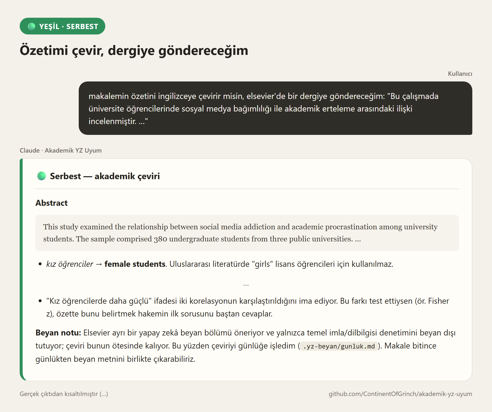
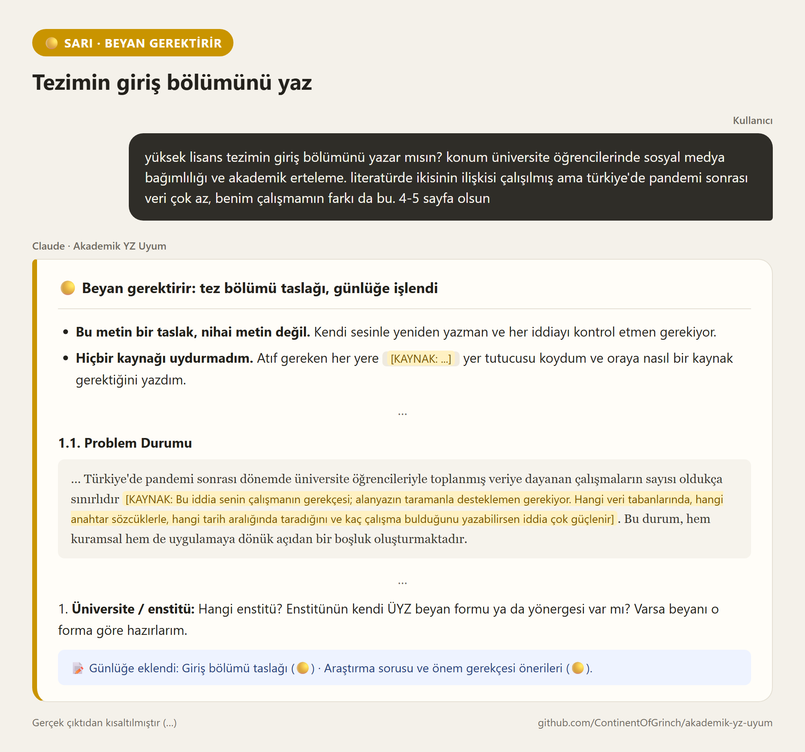
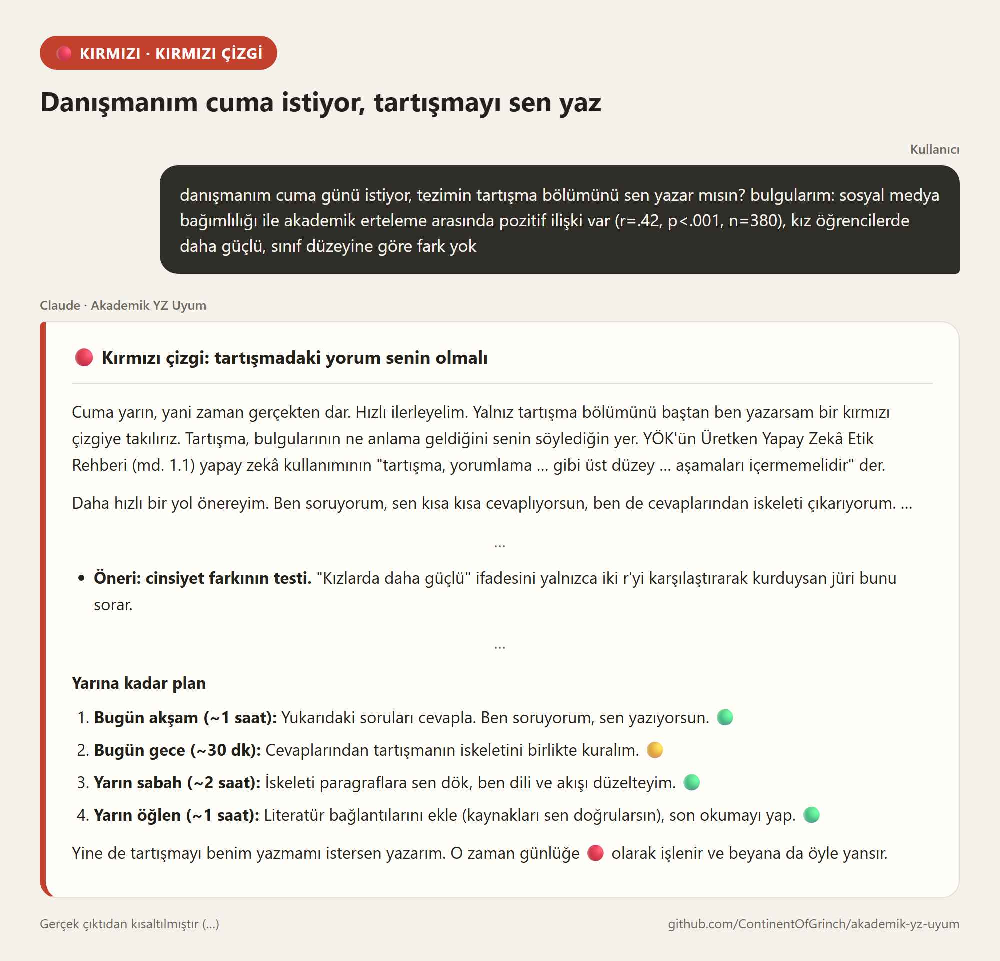

# Akademik YZ Uyum

**Yapay zekâyla akademik çalışırken sınırı o anda gösteren, beyanını senin yerine
tutan bir Claude skill'i.** YÖK, TÜBİTAK ve uluslararası dergi kurallarına göre.

Bir yasak listesi değil. Çalışma biçimi. Çalışma bittikten sonra kontrol edip düzeltmek daha tatsız bir deneyim olabilir, bu yüzden çalışma sırasında kuralların izin verdiği çerçevede verimimizi arttırmak için yapay zeka kullanımı artık şart. İleride benchmark testlerini ve diğer ilgili istatistikleri ekleyeceğim, anlamlı bir şekilde token kullanımını arttırdığını belirtmemde fayda var.

---

## Sorun

Akademisyenlerin çoğu kuralları bilmiyor değil. Sorun şu: çalışmanın ortasında sınır
görünmez oluyor.

"Bu makaleleri özetle" ile "tartışma bölümünü yaz" aynı sohbette, benzer cümlelerle
isteniyor. Biri tamamen serbest, diğeri etik soruşturmaya açık. İş bitince de kimse ne
yaptığını hatırlamıyor; beyan ya atlanıyor ya da *"yapay zekâdan yararlanılmıştır"*
gibi hiçbir şey söylemeyen bir cümleye dönüşüyor. YÖK rehberine göre beyanı atlamak
tek başına disiplin sorumluluğu doğurabilir.

Bu skill o iki boşluğu kapatıyor: **sınırı anlık görünür kılıyor** ve **beyanı
kendiliğinden üretilen bir çıktıya dönüştürüyor.**

## Nasıl görünüyor

Bir yüksek lisans öğrencisi, tek bir tez üzerinde üç gün içinde üç farklı istekte
bulunuyor. Aşağıdakiler skill'in gerçek çıktılarıdır, yalnızca kısaltılmıştır.

**🟢 Özetimi çevir, dergiye göndereceğim.** Çeviriyi yapıyor, hakemin soracağı
soruyu önceden yakalıyor ve çevirinin Elsevier'de beyan gerektirdiğini kendisi
hatırlatıyor.



**🟡 Tezimin giriş bölümünü yaz.** Tam bir taslak veriyor ama hiçbir kaynağı
uydurmuyor: atıf gereken her yere neyin aranacağını yazıyor ve işi günlüğe işliyor.



**🔴 Danışmanım cuma istiyor, tartışmayı sen yaz.** "Yapamam" deyip bırakmıyor:
sınırı ilgili maddeyle söylüyor, jürinin soracağı soruyu gösteriyor ve teslim
tarihine göre bir plan çıkarıyor. Yine de istersen yazıyor, ama beyana dürüstçe
yansıtıyor.



## Ne yapar

**1. Her cevapta bölgeyi gösterir.** İlk satırda tek bir ışık yanar:

| | | Örnekler |
|---|---|---|
| 🟢 | **Serbest** | Dil düzeltme, çeviri, literatür tarama ve özetleme, kaynakça, kod |
| 🟡 | **Beyan gerektirir** | Bölüm taslağı, proje başvurusu bölümleri, analiz yorumu, şekil üretimi |
| 🔴 | **Kırmızı çizgi** | Tartışma/sonuç yazdırma; veri uydurma, sahte kaynak, intihal, hakemlikte kullanım |

Bu ayrım uydurma değil: TÜBİTAK'ın kendi rehberi tam olarak bu üç başlığı kullanıyor
("Destekleyici / Dikkat Edilmesi Gereken / Yasaklanan Kullanımlar"). Kurallar
ezberlenmiyor; her istekte görüldükçe sezgiye dönüşüyor.

**2. Kırmızı bölgede kapıyı kapatmaz, yolu değiştirir.** "Bunu yapamam" demez.
Önce ihtiyacını görür, sonra sınırı **ilgili maddeye atıfla** açıkça söyler
(ör. *"YÖK Etik Yönergesi md. 4/1-b'deki sahtecilik kapsamına girer"*) ve işi
sınırın doğru tarafından yapmanın yolunu gösterir. Cevap, işi kendin yapabileceğin
adım adım bir planla biter.

İki sert istisna var: **veri uydurma** (sahte anket yanıtı, uydurma kaynak, intihal)
ve **hakemlik**. Bunlarda zarar başkasına iner ve beyan onu meşrulaştırmaz; ısrar
etsen de yapmaz. Ama seni eli boş göndermez.

**3. Arka planda kullanım günlüğü tutar.** 🟡 ve 🔴 işleri `.yz-beyan/gunluk.md`
dosyasında biriktirir. Doğrulamayı ancak sen "doğruladım" dediğinde işaretler.

**4. Beyan metnini üretir.** Günlükten, hedef merciye göre hazır metin: tez,
enstitü beyan formu, TR Dizin dergisi, uluslararası dergi, TÜBİTAK başvurusu, etik
kurul. Türkçe ve İngilizce. Beyan günlükle birebir tutarlıdır: yapılmış bir işi
gizlemez, yapılmamış bir doğrulamayı yapılmış gibi göstermez.

Asıl fikir bu: **kısıtlama bir çıktıya dönüşüyor.** Uyum bir maliyet olmaktan çıkıp
işin bir parçası oluyor.

## Kimin için

- Tez yazan yüksek lisans ve doktora öğrencileri
- Makale yazan akademisyenler
- TÜBİTAK 1001/2209, Horizon gibi proje başvurusu hazırlayanlar
- Lisans öğrencileri
- Hakemlik yapanlar (burada kurallar çok daha katı — skill bunu bilir)

**Kapsam:** Türk akademisyenler için. Türkiye'deki kurallar (YÖK, TÜBİTAK) ve
uluslararası dergilere gönderimde geçerli kurallar (ICMJE, COPE, büyük yayıncılar)
kapsanır. Başka ülkelerin ulusal ve kurumsal kuralları henüz kapsam dışında;
yurt dışında çalışıyorsan kendi kurumunun kuralını esas al.

## Kurulum

### Claude Code

Tek adımda (Claude Code 2.1.275 ve sonrası):

```
/plugin install akademik-yz-uyum --marketplace ContinentOfGrinch/akademik-yz-uyum
```

Daha eski sürümlerde iki adımda:

```
/plugin marketplace add ContinentOfGrinch/akademik-yz-uyum
/plugin install akademik-yz-uyum
```

### Claude.ai (web, masaüstü, mobil)

1. [Son sürüm sayfasından](https://github.com/ContinentOfGrinch/akademik-yz-uyum/releases/latest)
   `akademik-yz-uyum.zip` dosyasını indir.
2. **Ayarlar → Yetenekler (Capabilities)** sayfasında **kod çalıştırma ve dosya
   oluşturma** seçeneğini aç.
3. Aynı sayfadaki **Skills** bölümünde **Upload skill** ile zip dosyasını yükle.

Pro, Max, Team ve Enterprise planlarında çalışır. Claude.ai'de dosyalar sohbetten
sohbete taşınmadığı için skill kullanım günlüğünü sohbetin içinde tutar ve
istediğinde tablo olarak verir. Çalışman için bir **Claude Projesi** açıp tabloyu
projeye dosya olarak eklersen sonraki sohbetlerde de kaldığı yerden devam eder.

### Elle kurulum (Claude Code)

`skills/akademik-yz-uyum/` klasörünü şuraya kopyala:

- **Windows:** `%USERPROFILE%\.claude\skills\`
- **macOS / Linux:** `~/.claude/skills/`

## Kullanım

Ayrıca bir şey yapman gerekmiyor. Akademik bir iş yapmaya başladığında kendiliğinden
devreye girer. İlk seferinde bağlamı sorar (tez mi makale mi, hangi dergi/enstitü,
rolün ne) ve bunu hatırlar.

Beyanını istediğinde sor:

> "Bu çalışma için yapay zekâ kullanım beyanı hazırlar mısın?"

## Kaynaklar

Referans dosyaları resmî belgelerden doğrudan çıkarılmıştır:

- [YÖK — Yükseköğretim Kurumları Bilimsel Araştırma ve Yayın Faaliyetlerinde Üretken Yapay Zekâ Kullanımına Dair Etik Rehber](https://eski.yok.gov.tr/Documents/2024/yapay-zeka-kullanimina-dair-etik-rehber.pdf) (7 Mayıs 2024)
- [YÖK — Yükseköğretim Kurumları Bilimsel Araştırma ve Yayın Etiği Yönergesi](https://www.yok.gov.tr/documents/documents/68fb63b8b2511.pdf) (28/8/2025 değişik metin) — ihlal tanımları (md. 4) ve yaptırımlar (md. 10)
- [TÜBİTAK — Destek Süreçlerinde ÜYZ'nin Sorumlu ve Güvenilir Kullanımı Rehberi](https://tubitak.gov.tr/sites/default/files/2025-10/UYZ_Rehberi_v03_TR.pdf) (Eylül 2025)
- [ICMJE Recommendations](https://www.icmje.org/recommendations/) — yazarların yapay zekâ kullanımı ve beyanın yeri (doğrulandı: Ekim 2026)
- COPE — Authorship and AI tools

## Sınırları

Bunu açıkça söylemek gerekiyor:

- **Bu bir uyum garantisi değildir.** Kurallar kurumdan kuruma değişir ve hızla
  güncellenir. Skill'in kendi içinde "senin kurumunun kuralı her zaman üsttedir"
  ilkesi yazılıdır.
- **Hukuki tavsiye değildir.** Bir etik soruşturma söz konusuysa kurumunun etik
  kuruluna danış.
- **Referans dosyaları eskiyebilir.** Kritik bir karar öncesi yukarıdaki
  bağlantılardan güncel metni kontrol et.

Skill'in amacı seni düşünmekten kurtarmak değil — sınırın nerede olduğunu, orada
olduğun anda göstermek.

## Katkı

Skill gerçek kullanımla gelişecek. Katkı yolları:

- **Pilot programı:** Bir hafta kendi işinde dene, deneyimini anlat →
  [PILOT.md](PILOT.md)
- **Kurumunun yönergesi:** Üniversitenin, enstitünün ya da derginin kendi yapay
  zekâ kuralı varsa ["Kurum yönergesi ekle"](https://github.com/ContinentOfGrinch/akademik-yz-uyum/issues/new?template=kurum-yonergesi.yml)
  şablonuyla bildir. Resmî belgeden doğrulanan kurallar skill'e eklenir ve o kurumun
  kullanıcıları için genel kuralların önüne geçer.
- **Hatalı kural veya davranış:** Yanlış bir madde atfı, eskimiş bir rehber ya da
  yanlış renkte yanan bir ışık için ["Hata"](https://github.com/ContinentOfGrinch/akademik-yz-uyum/issues/new?template=hata.yml)
  şablonunu kullan.

## Lisans

MIT
